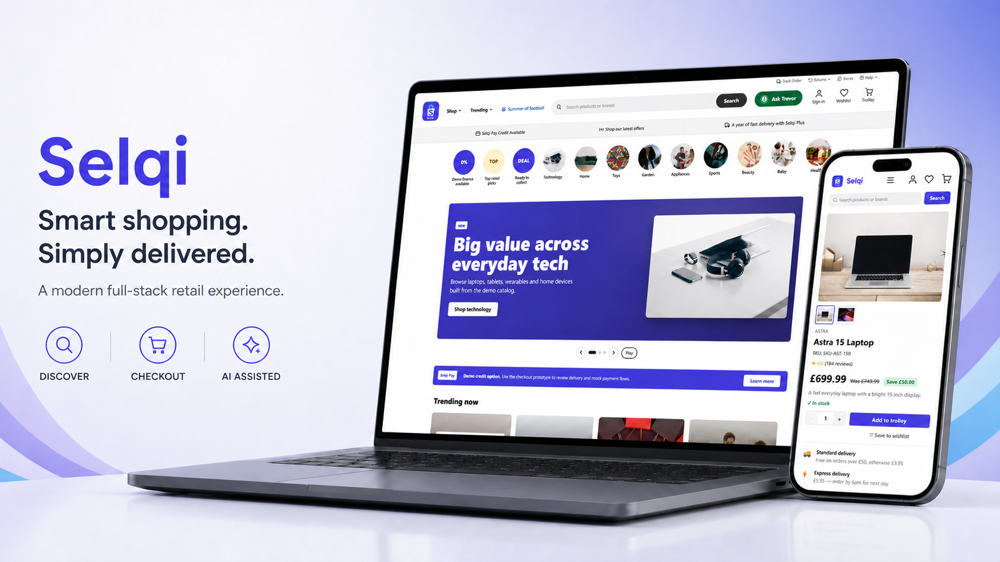
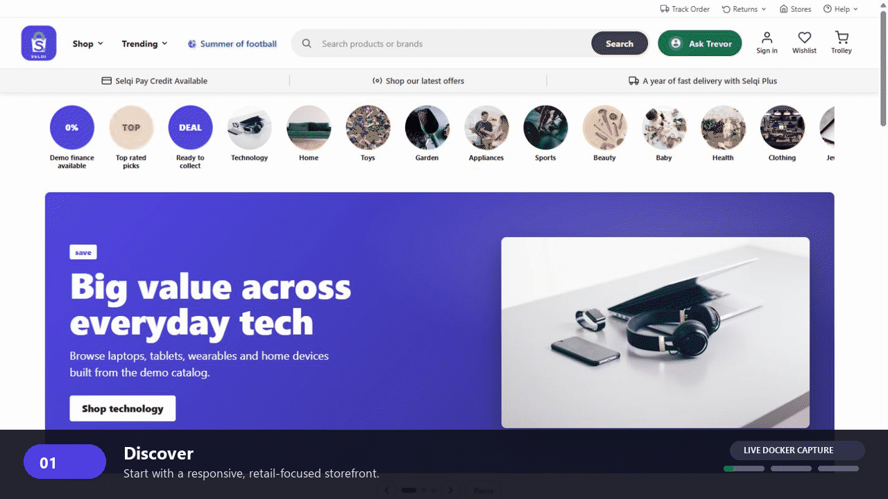
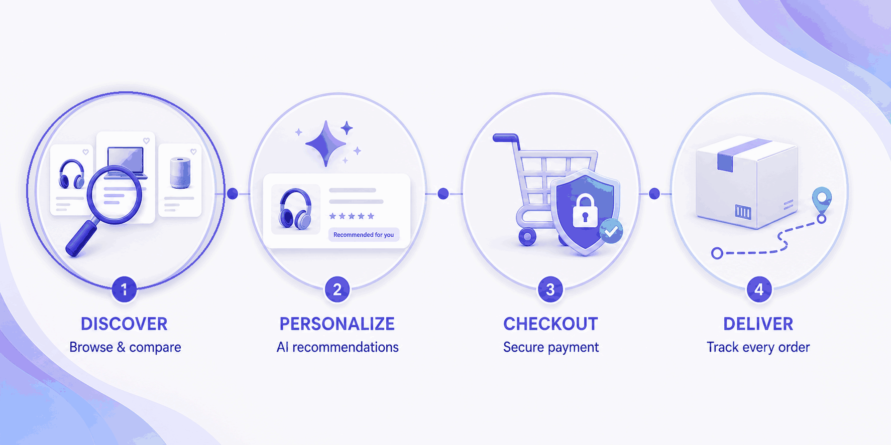
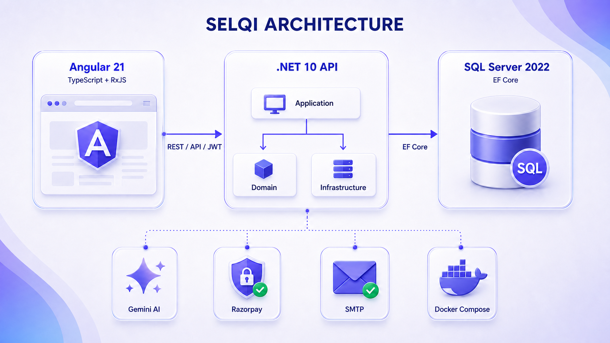
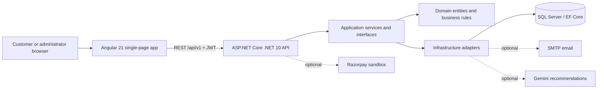

<p align="center">
  
</p>

<h1 align="center">Selqi Ecommerce Portal</h1>

<p align="center">
  A modern, full-stack retail experience built to demonstrate clean architecture,<br>
  secure commerce workflows, AI-assisted discovery, and reliable engineering practices.
</p>

<p align="center">
  
  
  
  
  <a href="LICENSE">
    
  </a>
</p>

## 🛍️ About Selqi

Selqi is a full-stack ecommerce demonstration that brings together customer shopping journeys, administrator operations, external integrations, and automated testing in one maintainable solution.

Customers can discover products, manage their account, build baskets and wishlists, complete checkout, and follow their orders. Administrators can manage products, stores, inventory, orders, and audit activity. Optional integrations add AI-assisted recommendations, email notifications, and sandbox payment processing.

> [!NOTE]
> Selqi is a demonstration project. Its interface uses original sample content and does not include proprietary retailer assets, production credentials, or real customer data.

## 📸 Application Preview

<p align="center">
  
</p>

<p align="center">
  <em>Responsive product discovery, AI-assisted shopping, secure checkout, and delivery workflows in one cohesive retail experience.</em>
</p>

### 🎬 Selqi in motion

<p align="center">
  
</p>

<p align="center">
  <em>A short walkthrough captured from the running Docker application: discover, explore, and evaluate products.</em>
</p>

## ✨ Key Features

### Customer experience

- Product discovery with categories, brands, sorting, pagination, and availability
- Secure registration, JWT authentication, and password recovery
- Basket, wishlist, saved addresses, and saved-card metadata
- Checkout with Razorpay sandbox payment support
- Order confirmation, history, status tracking, and PDF invoices
- AI-assisted product recommendations powered by Gemini

### Administration and operations

- Dashboard insights for retail operations
- Product, store, inventory, and order management
- Configurable inventory thresholds and product availability
- Administrative audit history
- Health checks, structured configuration, and Docker-based deployment

### Engineering quality

- Layered, dependency-inverted .NET architecture
- Strongly typed Angular application with reusable services and guards
- SQL Server schema management through Entity Framework Core migrations
- Automated xUnit, Vitest, and Playwright test suites
- GitHub Actions and Azure Pipelines configuration

### From discovery to delivery

<p align="center">
  
</p>

<p align="center">
  <em>A focused retail journey that turns product discovery into a secure, trackable order.</em>
</p>

## 🏗️ Architecture

<p align="center">
  
</p>

<p align="center">
  <em>A simplified platform view; the dependency-level flow remains documented below.</em>
</p>



The backend follows a clean layered design:

- **`Selqi.Domain`** contains framework-independent entities and business rules.
- **`Selqi.Application`** defines use cases, contracts, and service interfaces.
- **`Selqi.Infrastructure`** implements persistence and external integrations.
- **`Selqi.Api`** exposes HTTP endpoints and configures the application.

Read the detailed [architecture](docs/ARCHITECTURE.md) and [API design](docs/API_DESIGN.md) documentation.

## 🧰 Technology Stack

| Area           | Technology                                      |
| -------------- | ----------------------------------------------- |
| Frontend       | Angular 21, TypeScript 5.9, RxJS, SCSS          |
| Backend        | ASP.NET Core, .NET 10, C#                       |
| Data           | Entity Framework Core, SQL Server 2022          |
| Authentication | JWT bearer authentication                       |
| AI             | Google Gemini recommendations                   |
| Payments       | Razorpay sandbox                                |
| Email          | SMTP                                            |
| Testing        | xUnit, Vitest, Playwright                       |
| Delivery       | Docker Compose, GitHub Actions, Azure Pipelines |

## 🚀 Quick Start with Docker

Docker Desktop with Docker Compose is the simplest way to run the complete application.

### 1. Clone the repository

```powershell
git clone https://github.com/prakashinfotech/selqi.git
Set-Location selqi
```

### 2. Create local configuration

```powershell
Copy-Item .env.example .env
```

Open `.env` and replace `SELQI_DB_PASSWORD` with a strong local SQL Server password.

### 3. Start the complete stack

```powershell
docker compose up --build
```

| Service             | Address                        |
| ------------------- | ------------------------------ |
| 🖥️ Web application  | `http://localhost`             |
| 🔌 API              | `http://localhost:5000`        |
| 💚 API health check | `http://localhost:5000/health` |
| 🗄️ SQL Server       | `localhost:1433`               |

The API applies Entity Framework migrations and deterministic catalog seed data when it starts in Docker.

Stop the stack with:

```powershell
docker compose down
```

## 💻 Manual Development

### Prerequisites

- .NET 10 SDK
- Node.js 22 and npm 11
- SQL Server 2022 or SQL Server Express
- `sqlcmd` for the database helper script
- Playwright Chromium binaries only when running end-to-end tests

### Configure backend secrets

Use ASP.NET Core User Secrets for local values:

```powershell
dotnet user-secrets set "ConnectionStrings:SelqiDb" "Server=localhost\SQLEXPRESS;Database=SelqiDb;Trusted_Connection=True;TrustServerCertificate=True" --project src/backend/Selqi.Api
dotnet user-secrets set "Jwt:Secret" "<at-least-32-random-characters>" --project src/backend/Selqi.Api
```

SMTP, Razorpay, and Gemini are optional. Their configuration keys are documented in [Security and configuration](docs/SECURITY_AND_COMPLIANCE.md).

### Start the backend

```powershell
dotnet restore Selqi.slnx
dotnet tool restore
dotnet tool run dotnet-ef database update --project src/backend/Selqi.Infrastructure --startup-project src/backend/Selqi.Api
dotnet run --project src/backend/Selqi.Api
```

The local API runs at `http://localhost:5123`. Its development OpenAPI document is available at `http://localhost:5123/openapi/v1.json`.

### Start the frontend

In a second terminal:

```powershell
Set-Location src/frontend/selqi-ui
npm ci
npm start
```

Open `http://localhost:4200`.

## 🗄️ Database and Seed Data

`database/migrations/001_complete_schema_and_seed.sql` is an idempotent SQL Server script generated from all twelve Entity Framework migrations. It creates the complete schema and deterministic catalog, store, product-image, specification, and inventory data. Customer and administrator credentials are not seeded.

For Windows integrated authentication:

```powershell
.\scripts\init-database.ps1 -ServerInstance "localhost\SQLEXPRESS"
```

See [Database scripts](database/README.md) for SQL authentication, regeneration, and schema details.

## ✅ Build and Test

### Backend

```powershell
dotnet build Selqi.slnx -c Release
dotnet test Selqi.slnx -c Release --no-build
```

### Frontend

```powershell
Set-Location src/frontend/selqi-ui
npm ci
npm run build
npm test -- --watch=false
```

### End-to-end checkout flow

With the API and database running:

```powershell
Set-Location src/frontend/selqi-ui
npx playwright install chromium
npm run e2e
```

To test the Docker stack, set these variables before running Playwright:

```powershell
$env:E2E_BASE_URL = "http://localhost"
$env:E2E_API_BASE_URL = "http://localhost/api/v1"
npm run e2e
```

See the complete [testing strategy](docs/TESTING_STRATEGY.md).

## 📁 Repository Structure

```text
src/backend/                 .NET API, application, domain, and infrastructure
src/frontend/selqi-ui/       Angular application and Playwright scenarios
tests/backend/               xUnit application-service tests
database/                    SQL creation, migration, and seed scripts
scripts/                     Local development and database helpers
docs/                        Product, architecture, security, and operations guides
```

## 🔐 Security and Configuration

- Never commit connection passwords, JWT signing secrets, SMTP passwords, payment credentials, or Gemini keys.
- `.env`, `LOCAL_CREDENTIALS.md`, and local development settings remain Git-ignored.
- Tracked `appsettings*.json` files contain non-secret placeholders only.
- Supply production credentials through an approved secret store or environment variables.

Review [Security and compliance](docs/SECURITY_AND_COMPLIANCE.md) before deployment.

## 📚 Documentation

- [Contributing guide](CONTRIBUTING.md)
- [Security policy](SECURITY.md)
- [Product overview](docs/PRODUCT_OVERVIEW.md)
- [Functional documentation](docs/FUNCTIONAL_DOCUMENTATION.md)
- [Project structure](docs/PROJECT_STRUCTURE.md)
- [Architecture](docs/ARCHITECTURE.md)
- [API design](docs/API_DESIGN.md)
- [Database design](docs/DATABASE_DESIGN.md)
- [Testing strategy](docs/TESTING_STRATEGY.md)
- [Deployment guide](docs/DEPLOYMENT_GUIDE.md)
- [Payment integration](docs/PAYMENT_GATEWAY_INTEGRATION.md)
- [User journeys](docs/USER_JOURNEY_AND_INTERACTION_GUIDE.md)

## 📄 License

Licensed under the [MIT License](LICENSE). © 2026 Prakash Software Solutions Pvt. Ltd.
