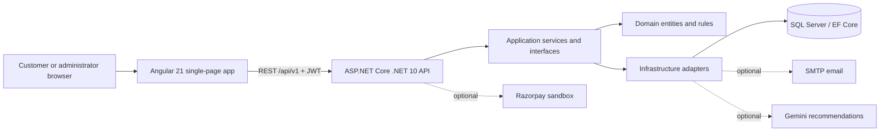

# Selqi Ecommerce Portal

A full-stack retail demonstration built with Angular 21, ASP.NET Core on .NET 10, Entity Framework Core, and SQL Server 2022. It supports product discovery, accounts, baskets, wishlists, addresses, checkout, order history, saved-card metadata, store inventory, AI-assisted recommendations, and administrator operations. The UI uses original demonstration content and does not include proprietary retailer assets.

## Application Flow and Architecture



The backend follows a dependency-inverted layered design: `Selqi.Domain` has no framework dependencies, `Selqi.Application` defines use cases and ports, `Selqi.Infrastructure` implements persistence and integrations, and `Selqi.Api` owns HTTP and composition. See [Architecture](docs/ARCHITECTURE.md) and [API design](docs/API_DESIGN.md).

## Repository Layout

```text
src/backend/                 .NET solution projects
src/frontend/selqi-ui/       Angular application and Playwright tests
tests/backend/               xUnit application-service tests
database/                    SQL database creation and full migration script
scripts/                     Database initialization helper
docs/                        Architecture, operations, and product documentation
```

## Prerequisites

The simplest setup requires Docker Desktop with Docker Compose. For manual development install the .NET 10 SDK, Node.js 22 with npm 11, SQL Server 2022/Express, and `sqlcmd`. Playwright browser binaries are required only for end-to-end tests.

## Clone and Configure

```powershell
git clone <repository-url>
Set-Location AI_Acceleration_Demo
Copy-Item .env.example .env
```

Edit `.env` and replace `SELQI_DB_PASSWORD` with a strong local password. `.env`, `LOCAL_CREDENTIALS.md`, and development settings are ignored. Tracked `appsettings*.json` files contain non-secret placeholders only. Configure manual-development secrets with ASP.NET Core User Secrets, for example:

```powershell
dotnet user-secrets set "ConnectionStrings:SelqiDb" "Server=localhost\SQLEXPRESS;Database=SelqiDb;Trusted_Connection=True;TrustServerCertificate=True" --project src/backend/Selqi.Api
dotnet user-secrets set "Jwt:Secret" "<at-least-32-random-characters>" --project src/backend/Selqi.Api
```

SMTP, Razorpay, and Gemini credentials are optional; their exact keys are listed in [Security and configuration](docs/SECURITY_AND_COMPLIANCE.md).

## Run with Docker

```powershell
docker compose up --build
```

The web application is available at `http://localhost`, the API at `http://localhost:5000`, and health checks at `http://localhost:5000/health`. The API automatically applies EF migrations and seed data when it starts in Docker. Stop the stack with `docker compose down`.

## Run Manually

```powershell
dotnet restore Selqi.slnx
dotnet tool restore
dotnet tool run dotnet-ef database update --project src/backend/Selqi.Infrastructure --startup-project src/backend/Selqi.Api
dotnet run --project src/backend/Selqi.Api
```

In a second terminal:

```powershell
Set-Location src/frontend/selqi-ui
npm ci
npm start
```

Open `http://localhost:4200`. The API listens on `http://localhost:5123`; its development OpenAPI document is at `/openapi/v1.json`.

## Database and Seed Data

`database/migrations/001_complete_schema_and_seed.sql` is an idempotent SQL Server script generated from all twelve EF migrations. It creates the complete schema and deterministic catalog, store, product-image, specification, and inventory seed data. No customer or administrator credentials are seeded.

For Windows integrated authentication:

```powershell
.\scripts\init-database.ps1 -ServerInstance "localhost\SQLEXPRESS"
```

See [Database scripts](database/README.md) for SQL authentication, regeneration, and schema details.

## Build and Test

```powershell
dotnet build Selqi.slnx -c Release
dotnet test Selqi.slnx -c Release --no-build

Set-Location src/frontend/selqi-ui
npm ci
npm run build
npm test -- --watch=false
```

With the API and database running, install Chromium once with `npx playwright install chromium`, then run `npm run e2e`. To test the Docker stack, set `$env:E2E_BASE_URL = "http://localhost"` and `$env:E2E_API_BASE_URL = "http://localhost/api/v1"` first. Backend tests use xUnit, frontend unit tests use Vitest through Angular CLI, and browser tests use Playwright. See [Testing strategy](docs/TESTING_STRATEGY.md).

## Additional Documentation

- [Project structure](docs/PROJECT_STRUCTURE.md)
- [Database design](docs/DATABASE_DESIGN.md)
- [Deployment guide](docs/DEPLOYMENT_GUIDE.md)
- [Payment integration](docs/PAYMENT_GATEWAY_INTEGRATION.md)
- [Functional documentation](docs/FUNCTIONAL_DOCUMENTATION.md)
