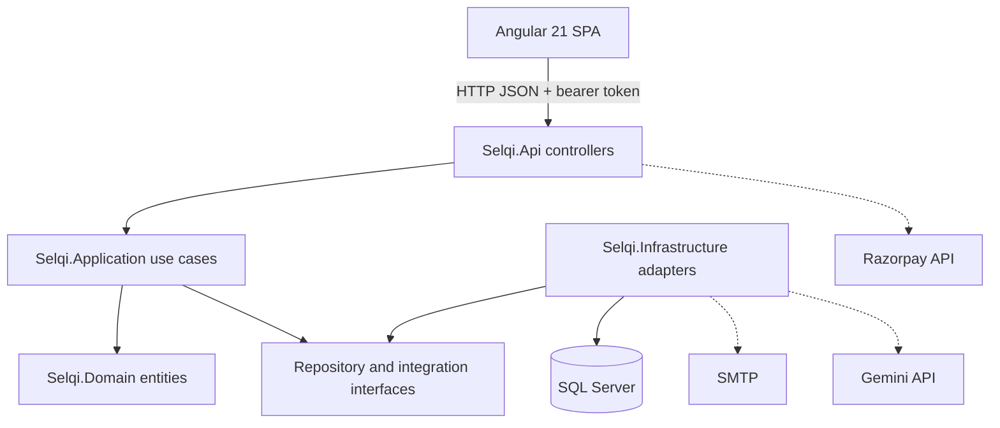

# Architecture

## Runtime View

`Selqi.Api` is the composition root and HTTP boundary. `Selqi.Application` owns orchestration and contracts. `Selqi.Domain` contains business entities and is framework-independent. `Selqi.Infrastructure` implements EF Core repositories, JWT generation, email, AI recommendations, and payment-supporting adapters.

## Frontend Organization

The Angular application uses standalone components. `core/` contains singleton services, guards, and interceptors; `shared/` contains reusable presentation code; `features/` owns route-level customer and administrator experiences. Services call the versioned `/api/v1` endpoints. Production builds use a relative API URL, which Nginx proxies to the API container.

## Request and Data Flow

1. The browser loads Angular and calls an API service.
2. The auth interceptor adds a JWT when the user is signed in.
3. A controller validates the HTTP contract and delegates to an application service.
4. The service applies rules through repository interfaces.
5. EF Core persists the aggregate to SQL Server and the controller returns JSON.

Authentication is stateless JWT. Customer-owned resources are scoped by the authenticated user identifier; administrator routes require the `Admin` role. Docker startup applies pending migrations before accepting requests.

## Architectural Rules

- Domain and Application must not reference API or Infrastructure.
- Controllers remain thin; business logic belongs in application services.
- Infrastructure integrations implement application interfaces and use typed options.
- Schema changes require an EF migration and regenerated idempotent SQL script.
- Never add secrets to source-controlled JSON, Compose files, tests, or documentation.
